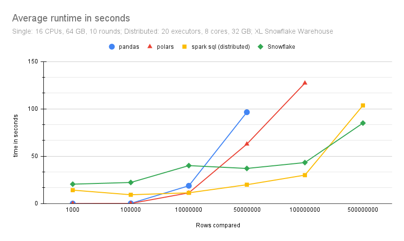

Benchmarks
==========

.. important::

    - Minimal tuning was done
    - Benchmarking is hard (and biased)
    - Take with a grain of salt

We've tried to create some benchmarks to help users understand which DataFrames to use when.
Please take the results with a grain of salt! If you have ideas on how we can further improve
preformance please make an issue, we always welcome contributions.

Setup used
----------

Single Machine:

- 16 CPUs
- 64GB RAM

Distributed Spark:

- 20 Executors
- 8 Cores
- 32GB RAM

The Data
---------

The data (base, and compare) we generated was purely synthetic consisting of 10 columns:

- 1 id (montonicly increasing) column used for joining
- 3 string columns
- 6 numeric columns

Table of mean benchmark times in seconds:

===========   =======   =======    ===============
Number of     pandas    polars     spark sql
rows                               (distributed)
===========   =======   =======    ===============
1000          0.025     0.025      14.1894
100,000       0.196     0.120      9.3198
10,000,000    18.804    11.330     11.3773
50,000,000    96.494    62.827     19.9034
100,000,000   DNR       127.194    30.0525
500,000,000   DNR       DNR        103.6135
===========   =======   =======    ===============

.. note:: DNR = Did not run

TLDR
----

* Polars can handle a lot of data and is fast!

  * From our experiments we can see that on a 64GB machine it was able to process 100 Million records

* The Spark SQL implementaion seems to be the most performant on very large datasets

  * It makes the Pandas on Spark implementation obsolete moving forward.

* The native Pandas version is best for small and medium data

SparkSQLCompare column statistics
---------------------------------

``SparkSQLCompare`` gathers the statistics for every compared column (match
count, max diff, null diff) and the row count in a single aggregation, so the
number of Spark jobs a comparison launches does not grow with the number of
columns. ``benchmarks/benchmark_spark_column_stats.py`` times the construction
of ``SparkSQLCompare`` (join plus column statistics) on synthetic float
columns, with about 10% of the values differing:

.. code-block:: bash

    python benchmarks/benchmark_spark_column_stats.py --rows 1000000 --cols 10 50
    python benchmarks/benchmark_spark_column_stats.py --rows 200000 --cols 200

Median of 5 runs on ``local[*]`` (Apple Silicon laptop, PySpark 4.3), before
and after the change:

=========   =======   ==================   =================   =============
rows        columns   before (s / jobs)    after (s / jobs)    speedup
=========   =======   ==================   =================   =============
1,000,000   10        3.85 / 78            2.82 / 36           1.4x
1,000,000   50        19.79 / 238          5.22 / 36           3.8x
200,000     200       95.48 / 838          12.07 / 36          7.9x
=========   =======   ==================   =================   =============

The machine was shared with other work while these ran, so the absolute times
are noisy; the job counts are exact.
